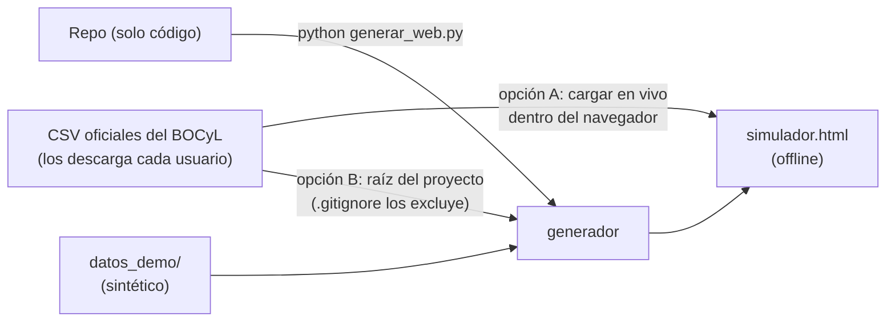
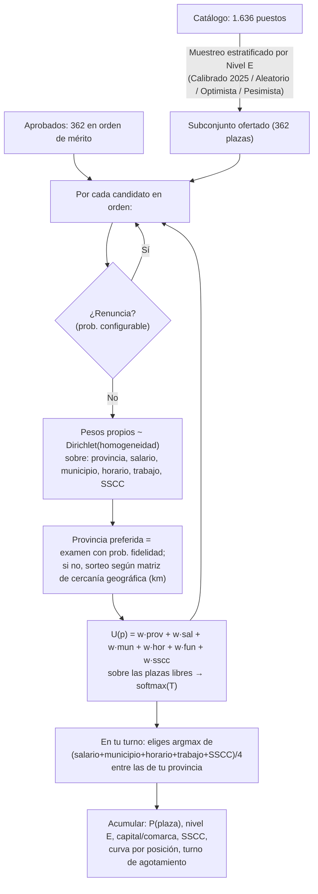

# 🎯 Simulador de destinos — CyL 2026

Simulación de Monte Carlo **multi-criterio** de la adjudicación de los 362 puestos de la oposición de auxiliar administrativo de C. y León, construida sobre tres fuentes de datos: orden de mérito de los aprobados (turno y provincia de examen), catálogo de ~1.600 puestos con Complemento Específico e histórico real de 380 plazas de 2025.

El producto final es **`simulador.html`**: una web autocontenida, **sin dependencias y sin conexión**, que se abre con doble clic.

> ⚠️ **Este repositorio no contiene datos personales.** La demo y los tests funcionan con un **dataset 100 % sintético** (`datos_demo/`) que replica las distribuciones agregadas reales. Para simular con datos reales, cárgalos tú en tu navegador o regenera la web en local: ver la [sección de datos](#3-los-datos-y-la-privacidad).
>
> Herramienta **no oficial**, sin afiliación con la Junta de Castilla y León y sin garantía alguna: es una ayuda para razonar sobre escenarios, no una predicción.

---

## 1. Índice de archivos

| Archivo | Qué es |
|---|---|
| [generar_web.py](generar_web.py) | Generador: lee los CSV (reales o sintéticos) y ensambla `simulador.html` + `datos.json`. |
| [generar_datos_demo.py](generar_datos_demo.py) | Crea el dataset sintético de `datos_demo/` (362 aprobados, 1.636 puestos, 380 plazas de histórico) sin ningún dato personal. |
| [datos_demo/](datos_demo/) | Los 3 CSV sintéticos, con el mismo formato que los reales. |
| [nucleo.js](nucleo.js) | Motor de simulación (JS puro, sin DOM) con muestreo estratificado 2025 y matriz de proximidad física. |
| [charts.js](charts.js) | Gráficas en canvas dibujadas a mano (barras, curva simple, curva comparativa doble, tornado). |
| [app.js](app.js) | Lógica de la interfaz: paneles, ejecución por trozos, sensibilidad, comparador de escenarios, exportador y **carga de CSV en vivo**. |
| [template.html](template.html) | Plantilla HTML+CSS con los marcadores de inyección. |
| [test_nucleo.js](test_nucleo.js) | 23 pruebas automáticas del motor (se ejecutan con Node). |
| [test_headless.js](test_headless.js) | Prueba headless de la interfaz completa (app.js con DOM simulado): KPIs y tornado. |
| [verificar_web.js](verificar_web.js) | Verificación estructural del HTML generado + benchmark de rendimiento. |
| [Instrucciones.md](Instrucciones.md) | Referencia completa de todos los controles de la web. |
| [legacy/Monte Carlo.py](legacy/Monte%20Carlo.py) | Prototipo original en pandas/numpy que motivó el proyecto (ver [legacy/](legacy/)). |
| [.github/workflows/demo.yml](.github/workflows/demo.yml) | CI: tests + publicación de la demo sintética en GitHub Pages. |

`simulador.html` y `datos.json` son **artefactos generados** (quedan fuera del repositorio mediante `.gitignore`) porque embeben los datos de entrada.

### Comandos

```bash
python generar_datos_demo.py     # (opcional) regenera el dataset sintético de datos_demo/
python generar_web.py            # genera simulador.html y datos.json (CSV reales si existen; si no, demo)
python generar_web.py --demo     # fuerza siempre el dataset sintético
node test_nucleo.js              # 23 pruebas del motor (datos, determinismo, límites, 2025…)
node test_headless.js            # 9 comprobaciones de la interfaz con DOM simulado (KPIs y tornado)
node verificar_web.js            # IDs, tokens, orden de scripts y velocidad
```

---

## 2. Los datos y la privacidad

### Qué consume el motor (y qué no)

De cada aprobado el motor solo usa **orden de mérito, turno (L/M) y provincia de examen**. Los nombres, identificadores fiscales y puntuaciones de las listas oficiales **no se embeben** nunca en `simulador.html` ni en `datos.json`: desde el punto de vista de la publicación son innecesarios.

### Cómo usar tus datos reales

**Opción A — sin regenerar nada (recomendada).** Abre `simulador.html` y usa el panel «📋 Datos y catálogo» para cargar en vivo:

- **Aprobados**: la resolución de admitidos/aprobados de tu convocatoria (se publica en el [BOCyL](https://bocyl.jcyl.es), Boletín Oficial de Castilla y León) exportada a CSV con columnas `Nº Orden`, `Turno` y `Provincia examen` (las columnas de más, como nombres o puntuaciones, se ignoran).
- **Catálogo**: la relación de puestos posibles con columnas `Provincia`, `Municipio`, `Localidad`, `Funciones`, `Puesto Tipo`, `Nombre del Puesto`, `Descripción del órgano` y `Consejería` + `Complemento Específico`.
- **Histórico** de la convocatoria anterior (opcional, para calibrar): `2025.csv` con `Provincia` y nivel `ESP`.

Los datos cargados **no salen de tu navegador**: la web es offline y no envía nada a ningún sitio.

**Opción B — regenerar la web en local.** Coloca `Aprobados.csv`, `Relación posibles puestos.csv` y `2025.csv` en la raíz del proyecto y ejecuta `python generar_web.py`. Esos tres ficheros están excluidos por `.gitignore`: **nunca los subas al repositorio** ni commitees el `simulador.html` resultante.

### Dataset sintético de demo

`datos_demo/` contiene tres CSV ficticios (nombres tipo «DEMO 001, OPOSITOR/A») que replican exactamente las distribuciones agregadas de una convocatoria real, de modo que toda la maquinaria (generador, tests, demo pública) funciona igual que con datos reales:

- **362 aprobados** (Turno M: 11), con la misma distribución por provincia de examen.
- **1.636 puestos** con los mismos conteos por provincia y nivel E (55 E06, 88 E04, 143 E03, 1.350 E02), incluidos 279 de Servicios Centrales en Valladolid.
- **380 plazas** de histórico con el mismo reparto por provincia, nivel E y SSCC/territorial.

| Provincia | E06 | E04 | E03 | E02 | SSCC | Total |
|---|---|---|---|---|---|---|
| Valladolid | 6 | 5 | 38 | 377 | 279 (65%) | 426 |
| León | 8 | 13 | 18 | 196 | — | 235 |
| Burgos | 9 | 11 | 12 | 159 | — | 191 |
| Salamanca | 10 | 11 | 17 | 142 | — | 180 |
| Segovia | 3 | 9 | 11 | 107 | — | 130 |
| Zamora | 3 | 18 | 11 | 98 | — | 130 |
| Ávila | 6 | 9 | 15 | 84 | — | 114 |
| Palencia | 5 | 7 | 10 | 96 | — | 118 |
| Soria | 5 | 5 | 11 | 91 | — | 112 |
| **Total** | **55** | **88** | **143** | **1.350** | **279** | **1.636** |

### Flujo de datos



---

## 3. Novedades y mejoras implementadas

| # | Mejora | Descripción | Dónde |
|---|---|---|---|
| 1 | **Corrección visual de carga de CSV** | Selectores de archivo reorganizados en vertical, ocupando el 100% de ancho sin solapamientos. | Panel «📋 Datos y catálogo» |
| 2 | **Preset Oferta 2025 (380→362)** | Distribución provincial exacta del año anterior escalada a 362 plazas (`[126, 38, 37, 30, 28, 28, 33, 24, 18]`). | Panel «🪑 Plazas» |
| 3 | **Escenario Calibrado 2025** | Muestreo estratificado por provincia y por nivel E (`E06, E04, E03, E02`) según los ratios reales de 2025. | Panel «🎲 Escenario» |
| 4 | **Matriz de proximidad geográfica** | Las segundas preferencias (por infidelidad o agotamiento) se ponderan por la distancia física en km entre provincias de CyL. | Panel «🧠 Comportamiento» |
| 5 | **Desglose Servicios Centrales (SSCC)** | Diferenciación y utilidad configurable para puestos en SSCC de Valladolid vs Administración Territorial. | Catálogo, Utilidades y Resultados |
| 6 | **Comparador de escenarios y perfiles** | Guarda dos simulaciones (A y B), compáralas en tabla y superpone sus curvas de disponibilidad. | Panel «⚖️ Comparador» |
| 7 | **Exportación de informes y CSV** | Informes listos para imprimir / PDF y descarga de datos completos en CSV. | Panel «📈 Resultados» |
| 8 | **Corrección P(plaza) y tornado** | El KPI principal mide **P(plaza en tu 1ª provincia)** con su IC; el tornado usa esa métrica, elimina la fila fantasma `__base__`, ordena por impacto y avisa si el resultado es constante. | Paneles «📈 Resultados» y «🌪️ Tornado» |

---

## 4. El modelo de simulación



La referencia completa de controles y supuestos está en [Instrucciones.md](Instrucciones.md).

---

## 5. Verificación

Ejecutadas sobre el dataset sintético (mismas distribuciones agregadas que los datos reales):

- **Pruebas unitarias**: `node test_nucleo.js` → **23/23 PASS** (determinismo, límites, monotonía de la curva, coherencia de distribuciones, intervalo de Wilson, caso 0 plazas, escenario calibrado 2025, clasificación SSCC y matriz de proximidad).
- **Interfaz headless**: `node test_headless.js` → **9/9 PASS** (KPI de 1ª provincia coherente con la curva y tornado no degenerado).
- **Estructural y rendimiento**: `node verificar_web.js` → IDs validados, tokens correctos, scripts en orden y rendimiento de ~1.000 simulaciones/s.
- Todo se ejecuta automáticamente en CI (`.github/workflows/demo.yml`) en cada push.

---

## 6. Legacy

[`legacy/Monte Carlo.py`](legacy/Monte%20Carlo.py) es el prototipo original (numpy/pandas, un único escenario, pesos constantes) que motivó este proyecto. Se conserva como referencia histórica; el motor actual es `nucleo.js`. Sus dependencias (`numpy`, `pandas`) están en [`legacy/requirements.txt`](legacy/requirements.txt): el generador principal (`generar_web.py`) solo usa la librería estándar de Python.

---

## 7. Licencia y aviso

- Código bajo licencia [MIT](LICENSE).
- Los datos sintéticos de `datos_demo/` se ofrecen tal cual, sin restricción.
- **Herramienta no oficial**, creada por y para opositores: sin afiliación con la Junta de Castilla y León, sin garantía de exactitud y sin valor probatorio. Las adjudicaciones reales dependen únicamente de las resoluciones oficiales publicadas en el [BOCyL](https://bocyl.jcyl.es).

---
*Oposición auxiliar CyL 2026 · Simulación Monte Carlo multi-criterio.*
