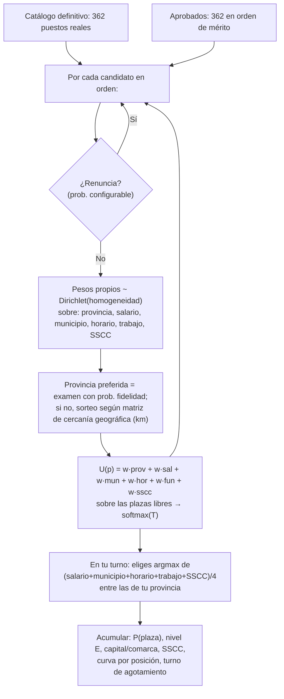

# 🎯 Simulador de destinos — CyL 2026

**[🚀 Acceder al Simulador Web (Clic aquí)](https://senabria.github.io/simulador-destinos-cyl/)**

Simulación de Monte Carlo **multi-criterio** de la adjudicación de los 362 puestos de la oposición de auxiliar administrativo de Castilla y León, construida sobre los datos reales: orden de mérito, turno y provincia de examen de los 362 aprobados, y el **catálogo definitivo de los 362 puestos convocados** (`Relación posibles puestos.csv`, formato oficial de la Resolución).

El producto final es **[simulador.html](simulador.html)**: una web autocontenida, **sin dependencias y sin conexión**, que se abre con doble clic. Los datos cargados **no salen de tu navegador**: la web es offline y no envía nada a ningún sitio.

> ⚠️ **Herramienta no oficial**, creada por y para opositores: sin afiliación con la Junta de Castilla y León, sin garantía de exactitud y sin valor probatorio. Las adjudicaciones reales dependen únicamente de las resoluciones oficiales publicadas en el [BOCyL](https://bocyl.jcyl.es).

---

## 1. Índice de archivos

| Archivo | Qué es |
|---|---|
| [simulador.html](simulador.html) | **La aplicación final**. Datos embebidos + motor + interfaz. Doble clic y listo. |
| [Aprobados.csv](Aprobados.csv) | Listado oficial: orden de mérito, turno L/M y provincia de examen de los 362 aprobados. |
| [Relación posibles puestos.csv](Relación posibles puestos.csv) | **Catálogo definitivo**: los 362 puestos convocados con nivel ESP (E06–E02), localidad, provincia (código INE), requisitos y unidad orgánica. Codificación CP850. |
| [generar_web.py](generar_web.py) | Generador: lee los CSV y ensambla `simulador.html` a partir de las piezas. |
| [nucleo.js](nucleo.js) | Motor de simulación (JS puro, sin DOM) con matriz de proximidad física. |
| [charts.js](charts.js) | Gráficas en canvas dibujadas a mano (barras, curva simple, curva comparativa doble, tornado). |
| [app.js](app.js) | Lógica de la interfaz: paneles, ejecución por trozos, sensibilidad, comparador de escenarios y exportador. |
| [template.html](template.html) | Plantilla HTML+CSS con los marcadores de inyección. |
| [test_nucleo.js](test_nucleo.js) | 22 pruebas automáticas del motor (se ejecutan con Node). |
| [test_headless.js](test_headless.js) | Prueba headless de la interfaz completa (app.js con DOM simulado): KPIs y tornado. |
| [verificar_web.js](verificar_web.js) | Verificación estructural del HTML generado + benchmark de rendimiento. |
| [datos.json](datos.json) | Volcado de los datos embebidos, usado por las pruebas. |
| [Monte Carlo.py](Monte Carlo.py) | Análisis simple independiente (replica el reparto definitivo por provincia). |

> ℹ️ `2025.csv` ya **no se usa**: el catálogo es la oferta definitiva, no hay recorte ni muestreo de subconjuntos.

### Comandos

```bash
python generar_web.py     # regenera simulador.html y datos.json desde los CSV
node test_nucleo.js       # 22 pruebas del motor (datos, determinismo, límites…)
node test_headless.js     # 9 comprobaciones de la interfaz con DOM simulado (KPIs y tornado)
node verificar_web.js     # IDs, tokens, orden de scripts y velocidad
```

---

## 2. Novedades y Mejoras Implementadas

| # | Mejora | Descripción | Dónde |
|---|---|---|---|
| 1 | **Catálogo definitivo 362** | Parser nuevo para el formato oficial de la Resolución (localiza columnas **por nombre**, tolerante a reordenaciones; provincias por código INE; codificación CP850). En cada simulación compiten los 362 puestos reales, sin muestreo. | `generar_web.py`, `nucleo.js` |
| 2 | **Corrección visual de carga de CSV** | Selectores de archivo reorganizados en vertical, ocupando el 100% de ancho sin solapamientos. | Panel «📋 Datos y catálogo» |
| 3 | **Matriz de proximidad geográfica** | Las segundas preferencias (por infidelidad o agotamiento) se ponderan por la distancia física en km entre provincias de CyL. | Panel «🧠 Comportamiento» |
| 4 | **Desglose Servicios Centrales (SSCC)** | Diferenciación y utilidad configurable para puestos en SSCC de Valladolid vs Administración Territorial. | Catálogo, Utilidades y Resultados |
| 5 | **Comparador de escenarios y perfiles** | Permite guardar dos simulaciones (A y B), compararlas en tabla y superponer sus curvas de disponibilidad en la gráfica. | Panel «⚖️ Comparador» |
| 6 | **Exportación de informes y CSV** | Generación de informes listos para imprimir / PDF y descarga de datos completos en CSV. | Panel «📈 Resultados» |
| 7 | **Corrección P(plaza) y tornado** | El KPI principal mide ahora **P(plaza en tu 1ª provincia)** (con su IC); antes `got` contaba cualquier plaza (fallback de `aceptaOtras`) y mostraba 100% engañoso. El tornado usa la métrica de 1ª provincia, elimina la fila fantasma `__base__` (NaN) que dejaba el gráfico vacío, ordena las barras por impacto y avisa si el resultado es constante. | Paneles «📈 Resultados» y «🌪️ Tornado» |

---

## 3. Los datos

### Aprobados (362)
- Orden de mérito real, turno **L** (351) y **M** (11, en las posiciones 41, 59, 65, **108 (Zamora)**, 156, 260 y 358-362).
- Provincia de examen: Valladolid 118, Salamanca 62, León 47, Burgos 37, **Zamora 30**, Segovia 21, Palencia 21, Ávila 13, Soria 13.
- Perfil por defecto: **posición 100, provincia preferida Zamora** (fidelidad 90 %, renuncias 3 % — en la convocatoria 2025 renunciaron solo ~5 de 380 adjudicatarios, ≈1,3 %).

### Catálogo definitivo (362 puestos convocados)
| Provincia | E06 | E04 | E03 | E02+ | Total |
|---|---|---|---|---|---|
| Valladolid | 2 | 1 | 12 | 88 | 103 |
| León | 1 | 0 | 3 | 41 | 45 |
| Burgos | 3 | 4 | 0 | 32 | 39 |
| Salamanca | 2 | 3 | 3 | 23 | 31 |
| Segovia | 1 | 4 | 4 | 23 | 32 |
| **Zamora** | **0** | **1** | **2** | **21** | **24** |
| Ávila | 2 | 3 | 4 | 22 | 31 |
| Palencia | 4 | 1 | 1 | 27 | 33 |
| Soria | 0 | 2 | 1 | 21 | 24 |
| **Total** | **15** | **19** | **30** | **298** | **362** |

> Incluye 31 puestos de «Otros Cuerpos Similares» (A5) que se tratan como solicitables. Las celdas ESP vacías se computan como E02.

---

## 4. El modelo de simulación



---

## 5. Verificación realizada

- **Pruebas unitarias**: `node test_nucleo.js` → **22/22 PASS** (integridad 362/362, determinismo, monotonía, distribuciones, Wilson, SSCC, proximidad).
- **Interfaz headless**: `node test_headless.js` → **9/9 PASS** (turno 362 + Salamanca: P(1ª provincia) = 0 %, coherente con la curva; turno 100 + Zamora: 100 %).
- **Estructural y rendimiento**: `node verificar_web.js` → **76 IDs validados**, tokens correctos, scripts en orden y rendimiento de **~1.050 simulaciones/s**.

---
*Generado por `generar_web.py` · Oposición auxiliar administrativo CyL 2026 · Simulación Monte Carlo multi-criterio.*
